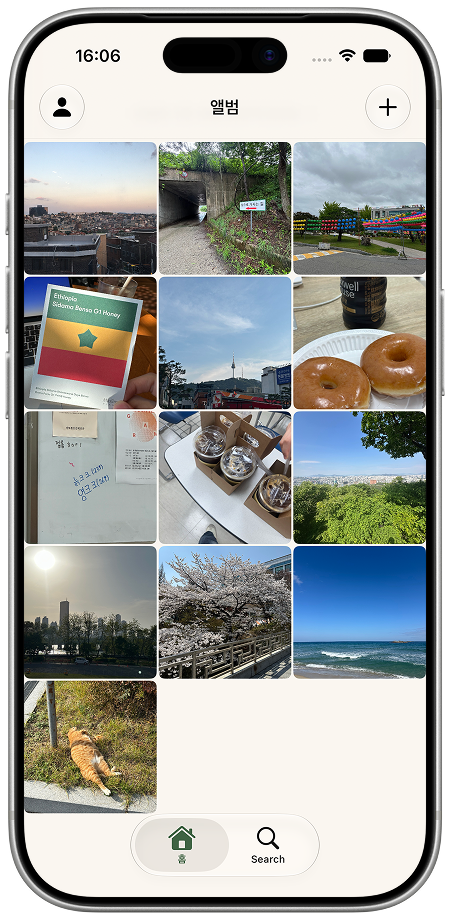
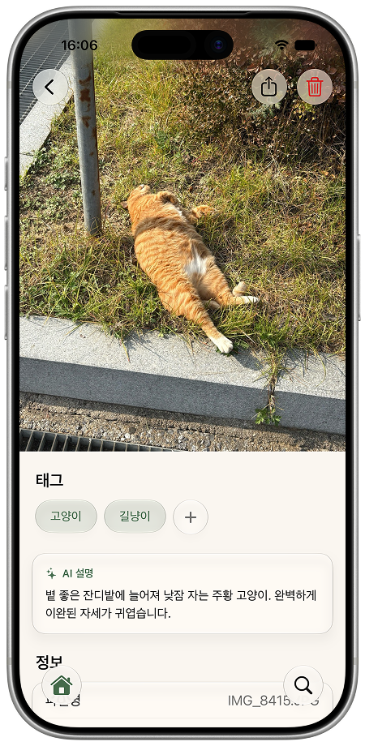
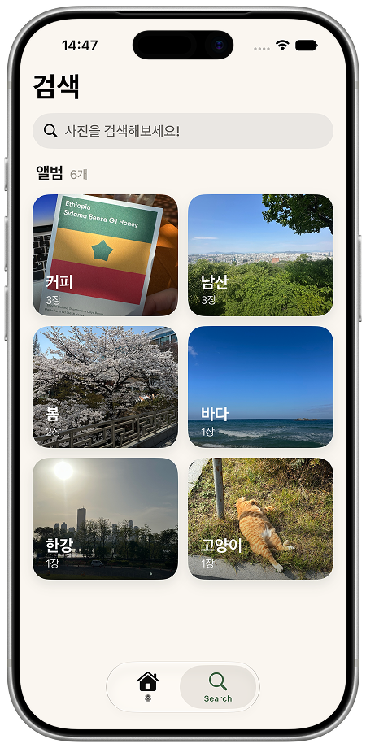

# Rephoto

고령층을 위한 AI 사진 관리 앱 — 사진을 올리면 AI가 자동으로 설명과 태그를 달아주고, 일상적인 문장으로 사진을 찾을 수 있습니다.


## 스크린샷

| 홈 | 사진 상세 | 자연어 검색 |
|:---:|:---:|:---:|
|  |  |  |

## 주요 기능

- **사진 업로드 + AI 분석** — 사진을 올리면 서버의 VLM이 자동으로 설명과 태그를 생성합니다. 여러 장을 선택하면 병렬로 업로드됩니다.
- **자연어 검색** — "바다에서 찍은 사진"처럼 문장으로 사진을 검색할 수 있습니다.
- **태그 앨범** — AI가 생성한 태그로 사진을 자동 분류해 앨범으로 보여줍니다.
- **태그 편집** — 사진 상세에서 태그를 직접 추가·수정·삭제할 수 있습니다.
- **민감한 사진 보호** — 개인정보나 문서가 포함된 사진은 홈에서 분리되고, Face ID 인증 후에만 볼 수 있습니다.
- **위치 정보** — 촬영 시점의 GPS 정보를 추출해 사진 상세에서 지도로 보여줍니다.

## 요구 사항

- iOS 26.0+
- Xcode 26.0+
- Swift 5 (기존 프로젝트) · Swift 6 (Tuist 워크스페이스)
- Tuist 워크스페이스: [mise](https://mise.jdx.dev) — Tuist · mockolo 버전을 `Rephoto/mise.toml`로 고정

## 아키텍처

### Tuist 멀티모듈 전환 (진행 중)

단일 앱 타깃을 Tuist 워크스페이스(`Rephoto/`)의 4계층 모듈로 옮기고 있습니다. 전환이 끝날 때까지 기존 프로젝트(`Rephoto_iOS.xcodeproj`)와 CI를 함께 유지합니다.

| 계층 | 모듈 | 역할 |
|------|------|------|
| App | `Projects/App` | 유일한 조립 지점 — `AppContainer`가 구현을 등록 |
| Feature | Home · Search (User 예정) | 화면 · ViewModel |
| Domain | Photo · Tag · Album · PreviewSupport (User 예정) | 모델 · UseCase · Repository |
| Core | NetworkAdapter | 네트워크 · 인증 |
| Shared | Foundation · DesignSystem | 에러 · 설정 · 색상 · 공용 UI |

- **모듈 = Tuist 프로젝트 1개** — 타깃은 `Interface · Sources · Testing · Tests` 중 필요한 것만 둡니다. Feature에는 그 화면만 단독 실행하는 `Example` 앱을 추가해, 서버와 로그인 없이 동작을 확인한 뒤 App에 조립합니다.
- **의존 규칙** — 아래 계층은 위 계층을 모릅니다. Feature는 다른 Feature · Domain의 Interface만 참조하고, 구현은 App 타깃에서 조립합니다. 구현 모듈 import는 CI(`.github/workflows/tuist.yml`)가 막습니다.
- **모듈 추가 자동화** — 폴더 구조에서 모듈 enum을 생성하는 `DependencyPlugin`으로 의존성을 문자열 경로 대신 타입(`.feature(interface: .Home)`)으로 선언하고, 새 모듈은 `make module type=<feature|domain|core|shared> name=<Name>`으로 만듭니다.
- **Swift 6** — 새 워크스페이스는 전 모듈 Swift 6 언어 모드입니다.

```bash
cd Rephoto
make install    # mise 도구(tuist · mockolo)와 SPM 의존성 설치
make generate   # Mock 생성 후 워크스페이스 생성
make open
```

단계별 범위와 결정 기록은 [docs/REFACTORING_HISTORY.md](docs/REFACTORING_HISTORY.md)의 Step 4, 전환 전 빌드 시간 기준값은 [docs/benchmarks/2026-10-29_build_time.md](docs/benchmarks/2026-10-29_build_time.md)에 있습니다.

### 기존 프로젝트 구조

아래는 전환 전 단일 타깃(`Rephoto_iOS/`)의 구조입니다. 기능(Feature) 단위로 폴더를 나누고, 각 기능을 Data / Domain / Presentation 3계층으로 분리했습니다.

```
Rephoto_iOS/
├── App/              # 앱 진입점 (@main, ContentView)
├── Core/             # 공통 인프라
│   ├── Config/           # 환경 설정 (BASE_URL)
│   ├── DIContainer/      # Factory 기반 DI 컨테이너
│   ├── Error/            # AppError · Loadable · ErrorHandler — 계층별 에러 정규화와 표시 경로
│   ├── NetworkAdapter/   # URLSession 기반 자체 네트워크 레이어
│   └── UIComponents/     # PhotoNavGrid · PhotoGridTile · ThumbnailTier · ErrorStateView
├── Features/
│   ├── Home/         # 사진 그리드 · 업로드 · 상세(태그/설명)
│   │   ├── Data/         # DTO · Repository 구현 · API Target
│   │   ├── Domain/       # UseCase · Model · Repository 인터페이스
│   │   └── Presentation/ # View · ViewModel
│   ├── Search/       # 자연어 검색 · 태그 앨범
│   └── User/         # 로그인 · 세션 · 설정
├── Resources/        # 에셋 · 공용 컴포넌트
└── Utilities/        # Keychain, Extensions
```

### 설계 패턴

- **Clean Architecture + MVVM** — View → ViewModel → UseCase → Repository 단방향 의존. Presentation은 Domain Model만 사용하고, DTO 매핑은 Data 계층에 격리됩니다.
- **Swift Concurrency** — `async/await` 전면 사용. 토큰 저장소와 네트워크 클라이언트는 `actor`로 구현해 동시 접근을 직렬화합니다.
- **자체 네트워크 레이어** — 엔드포인트를 `APITargetType` 프로토콜로 선언하면 `NetworkAdapter`가 `URLRequest`로 조립하고, `NetworkClient`(actor)가 Bearer 토큰 주입과 401 시 토큰 자동 갱신·재시도를 처리합니다.
- **의존성 주입** — `Factory`로 의존성을 등록하고, DEBUG 빌드에서는 Mock provider를 자동 주입해 SwiftUI Preview와 테스트를 네트워크 없이 격리합니다.

## 기술 포인트

- **토큰 갱신 직렬화** — 갱신 진행 중 도착한 동시 401 20건을 단일 갱신으로 합칩니다(`NetworkClient` actor, 단일 `Task` 합류). 갱신 실패 통지도 1회로 접고, 로그아웃은 진행 중인 갱신이 끝난 뒤 토큰을 지웁니다. 테스트로 고정.
- **업로드 전처리** — ImageIO 다운샘플로 페이로드 중앙값 −73%(받은 사진을 그대로 올리던 방식 대비), 목표 크기를 JPEG 1/2ⁿ 서브샘플 경계에 맞춰 장당 다운샘플·인코딩 시간 중앙값 −25%(정렬값이 1536px 미만이면 정렬 대신 2048px 요청). iPhone 14 Pro 1대 · 12MP 사진 15장 · Release 실측, [BASELINE_RESULTS.md](Rephoto_iOSTests/BASELINE_RESULTS.md).
- **에러 계층** — 계층별 에러를 `AppError`로 정규화하고, 화면 안에서 해결할 수 있는 실패는 `Loadable` 인라인, 흐름이 끊기는 실패는 전역 `ErrorHandler` Alert으로 나눕니다.

## 테스트 · CI

- 단위·계약 테스트 **95개**(Swift Testing 83 + XCTest 12) — `Rephoto_iOS.xctestplan`. 네트워크 코어(동시 401 → 갱신 1회, 로그아웃–갱신 경합, Keychain actor, 어댑터 조립)와 클라이언트 엔드포인트 명세 35케이스를 고정합니다.
- 성능 벤치 **18개** — `Rephoto_Performance.xctestplan`, 수동 실행. 측정 결과와 조건은 [BASELINE_RESULTS.md](Rephoto_iOSTests/BASELINE_RESULTS.md), 가이드는 [TESTING.md](Rephoto_iOSTests/TESTING.md).
- CI — PR마다 `build-for-testing` → `test-without-building` → `xccov` 커버리지 요약 (`.github/workflows/iOS.yml`). Tuist 워크스페이스는 `tuist.yml`에서 구현 모듈 import 검사 → `tuist inspect dependencies` → 빌드 → 테스트를 따로 돌립니다.

## 로컬 목 서버

백엔드는 운영이 종료됐습니다. 리팩토링은 로컬 목 서버 `mock_server.py`를 API 명세로 삼아 진행했고, 일부 경로·필드는 원 서버와 다릅니다. `mock_server.py`는 앱의 API 계약에 맞춰 데모 픽스처 14장을 내려주는 인메모리 서버입니다(`python3 mock_server.py`). DEBUG 빌드는 앱 내 목 provider, 네트워크 경로는 mock_server — 연결 절차(BASE_URL · DEBUG Mock 등록 해제)는 파일 상단 주석에 있습니다.

## 의존성

| 패키지 | 용도 |
|--------|------|
| [Factory](https://github.com/hmlongco/Factory) | 의존성 주입 |
| [Nuke](https://github.com/kean/Nuke) | 이미지 비동기 로딩 · 캐싱 |

## 라이선스

[MIT License](LICENSE) © 2025 Grit-23
